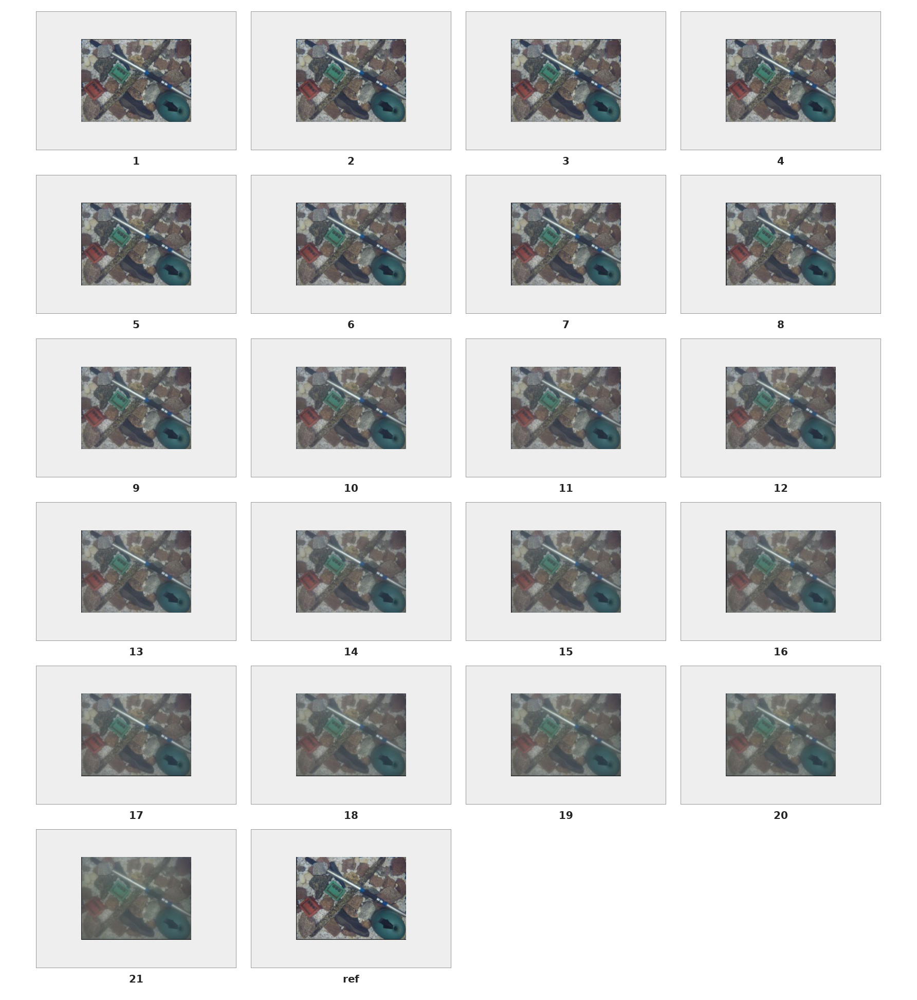
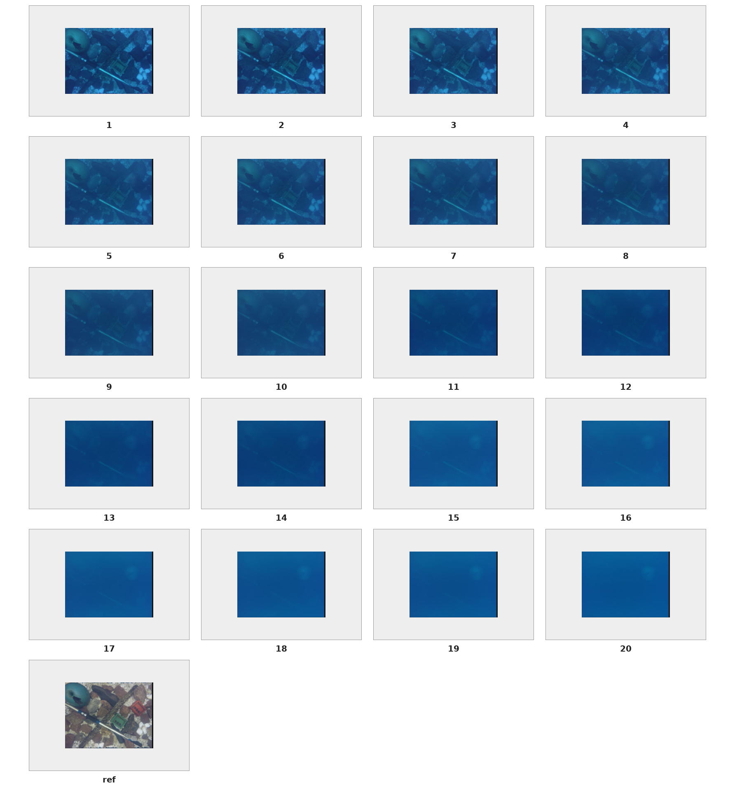
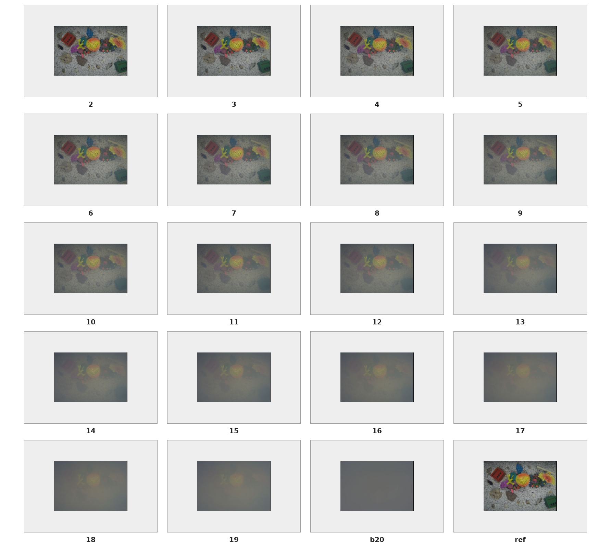

# TURBID: Underwater Image Dataset
<p align="center">
  <strong>A Research Resource for Underwater Image Enhancement and Restoration</strong>
</p>

<p align="center">
  
  
  
  
</p>


---

##  Overview

The **TURBID (Turbid Underwater Image Dataset)** was originally introduced by Duarte et al. for evaluating underwater image restoration methods.

This repository aims to facilitate access to the TURBID dataset by providing an organized collection of underwater images under different turbidity conditions. It is intended to support research and experimentation in underwater image enhancement, restoration, and dehazing.

The dataset comprises three underwater conditions:

- **Milk**
- **DeepBlue**
- **Chlorophyll**

Each category contains degraded underwater images at different turbidity levels, along with corresponding reference images for evaluation.

## Dataset Organization

The dataset is organized as follows:

```text
TURBID 3D/
│
├── Chlorophyll/
│   ├── frontView/
│   └── sideView/
│
├── DeepBlue/
│
└── Milk/
```

The reference images in the respective categories can be used for evaluating the restoration performance of different underwater image enhancement and dehazing algorithms.

## Dataset Visualization

The TURBID dataset consists of three underwater imaging conditions. The following visualizations present the image samples available in each category, illustrating the variations in underwater visibility, turbidity, and image degradation.

### 1. Chlorophyll



### 2. DeepBlue



### 3. Milk



## Dataset Access and References

The following links provide access to the original dataset information, its associated publication, and this repository.

| Resource                           | Link                                                                  |
| ---------------------------------- | --------------------------------------------------------------------- |
| **Original TURBID Website**        | [Amanda Duarte – TURBID](http://amandaduarte.com.br/turbid/)          |
| **Original Dataset Download Link** | [Dataset Download](https://mega.nz/!ZkgkSDJZ!ES9LgsZz0oUMnsfQyzBKgxamNx9KHrxAGyNvFjCwt8)             |
| **Original Research Paper**        | [Duarte et al. (2016)](https://doi.org/10.1109/OCEANSAP.2016.7485524) |
| **Current GitHub Repository**      | [TURBID Underwater Image Dataset](https://github.com/image03-pixel/TURBID-Underwater-Dataset) |

##  Citation

If you use the TURBID dataset in your research, please cite the original publication:

```bibtex
@inproceedings{duarte2016turbid,
  author    = {Duarte, Amanda and Codevilla, Felipe and
               De O. Gaya, Joel and Botelho, Silvia S. C.},
  title     = {A Dataset to Evaluate Underwater Image Restoration Methods},
  booktitle = {OCEANS 2016 - Shanghai},
  year      = {2016},
  doi       = {10.1109/OCEANSAP.2016.7485524}
}
```

##  Related Underwater Image Enhancement and Dehazing Methods

For researchers interested in evaluating and comparing underwater image restoration techniques, the following publicly available implementations are provided as additional research resources.

| No. | Method                                                                          | Source Code                                                                                                       |
| :-: | ------------------------------------------------------------------------------- | ----------------------------------------------------------------------------------------------------------------- |
|  1  | Bayesian Retinex Underwater Image Enhancement (BRUEM)                           | [GitHub](https://github.com/zhuangpeixian/Bayesian-Retinex-Underwater-Enhancement)                                |
|  2  | Contour Bougie Morphology (CBM)                                                 | [GitHub](https://github.com/bilityniu/cbm_tgrs)                                                                   |
|  3  | Saturation Line Prior (SLP)                                                     | [GitHub](https://github.com/LPengYang/Saturation-Line-Prior)                                                      |
|  4  | Minimal Color Loss and Locally Adaptive Contrast Enhancement (MMLE)             | [GitHub](https://github.com/Li-Chongyi/MMLE_code)                                                                 |
|  5  | Piecewise Color Correction and Dual Prior Optimized Contrast Enhancement (PCDE) | [GitHub](https://github.com/Li-Chongyi/PCDE)                                                                      |
|  6  | Dark Channel Haze Removal (DCHR)                                                | [GitHub](https://github.com/sjtrny/Dark-Channel-Haze-Removal)                                                     |
|  7  | Dual High-Order Total Variation Model (UDHTV)                                   | [GitHub](https://github.com/Hou-Guojia/UDHTV)                                                                     |
|  8  | Wavelength Compensation and Dehazing (WCD)                                      | [GitHub](https://github.com/mohitkumarahuja/Underwater-Image-Enhancement-by-Wavelength-Compensation-and-Dehazing) |
|  9  | Underwater Normalized Total Variation (UNTV)                                    | [GitHub](https://github.com/Hou-Guojia/UNTV)                                                                      |
|  10 | Hybrid Fusion Method (HFM)                                                      | [GitHub](https://github.com/An-Shunmin/HFM)                                                                       |
|  11 | Rank-One Prior (ROP)                                                            | [GitHub](https://github.com/junliumath/ROP)                                                                       |
|  12 | Texture Enhancement Model Based on Blurriness and Color Fusion (TEBCF)          | [GitHub](https://github.com/bilityniu/TEBCF_tgrs)                                                                 |

*Note: These links are provided solely as additional research resources. The respective algorithms and implementations belong to their original authors. Please consult the individual repositories for licensing, implementation details, and citation requirements.*

---

